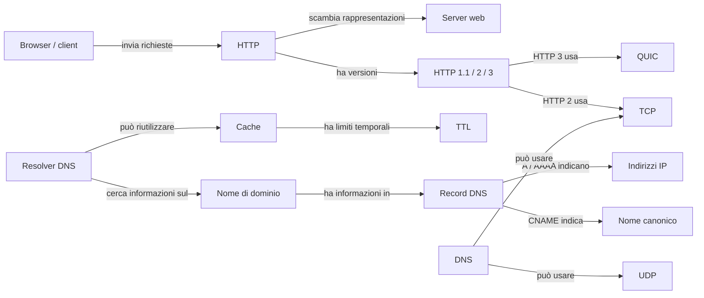

# 3. Mappa di concetti e relazioni

[Percorso](../README.md) · [Precedente](03-selezione.md) · [Successivo](05-registro.md)

> **Commento per il docente:** una mappa collega concetti con frasi leggibili. Ogni relazione esprime un'affermazione; indico le voci del registro che la sostengono.

La mappa rappresenta relazioni, non una sequenza obbligatoria di operazioni.

| Relazione esplicita | Registro |
|---|---|
| Il client invia richieste HTTP al server | C07 |
| Lo scambio HTTP riguarda rappresentazioni di risorse | C08 |
| A un nome DNS sono associate informazioni organizzate in record | C01 |
| A e AAAA rappresentano indirizzi; CNAME esprime un alias | C02, C03 |
| Un resolver può ricorrere a un servizio ricorsivo | C04 |
| Le informazioni in cache possono evitare interrogazioni ripetute | C05 |
| Una pagina può richiedere più risorse | C09 |
| HTTP/3 usa QUIC; il confronto deve indicare la versione | C11, C12 |
| DNS supporta UDP e TCP | C06 |

Un server autorevole fornisce dati della propria zona; un resolver cerca una risposta per il richiedente. Per la lezione basta distinguere questi ruoli, senza insegnare la configurazione delle zone. Il riferimento per il ruolo autorevole è C19. Il disegno omette volutamente root, deleghe, proxy e dettagli di connessione: consultarli non è necessario per gli obiettivi di questa introduzione.

[Consulta le fonti e gli esiti delle relazioni](05-registro.md).
